<div align="center">


# Student Grading System

**A desktop student grading and result management system built with C#, Windows Forms and MySQL.**

Instructors set up assessments, enter marks and calculate weighted final grades.<br/>
Students sign in to see their results and exactly how every mark counts.

[](https://kianis534.github.io/student-grading-system-csharp-mysql/)
[](https://github.com/Kianis534/student-grading-system-csharp-mysql/actions/workflows/ci.yml)
[](https://github.com/Kianis534/student-grading-system-csharp-mysql/releases/latest)
[](LICENSE)


[**Live demo**](https://kianis534.github.io/student-grading-system-csharp-mysql/) ·
[**Download**](https://github.com/Kianis534/student-grading-system-csharp-mysql/releases/latest) ·
[Getting started](#getting-started) ·
[Screenshots](#screenshots) ·
[Architecture](#architecture) ·
[Report a bug](https://github.com/Kianis534/student-grading-system-csharp-mysql/issues/new/choose)

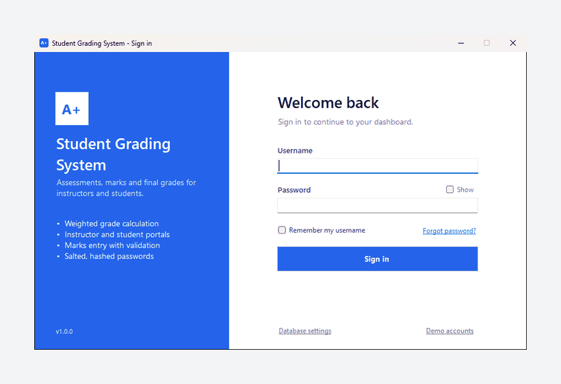

</div>

> [!TIP]
> **Try it in your browser, no download needed: [kianis534.github.io/student-grading-system-csharp-mysql](https://kianis534.github.io/student-grading-system-csharp-mysql/)**
> Click *Try as instructor* or *Try as student* and use the real workflow.

> [!IMPORTANT]
> **The live demo is for previewing only.** It runs on sample data that lives in your browser tab: nothing is saved to a server, and everything resets when you reload the page.
> To use the system for real, [download the desktop app](#getting-started) and connect it to **your own MySQL database**. The download, database setup and configuration work exactly as described in [Getting started](#getting-started).
>
> **It looks similar, not identical.** The demo is styled to mirror the desktop windows, but it's a web page, so fonts, window frames and controls such as number boxes and drop-downs won't match the real app exactly. The screenshots and GIF in this README show the real Windows app.

---

## Contents

- [Features](#features)
- [Live demo](#live-demo)
- [Screenshots](#screenshots)
- [Tech stack](#tech-stack)
- [Getting started](#getting-started)
  - [Prerequisites](#prerequisites)
  - [Option A: download the release](#option-a-download-the-release-no-build-needed)
  - [Option B: build from source](#option-b-build-from-source)
  - [Database setup](#database-setup)
  - [Demo accounts](#demo-accounts)
- [Configuration](#configuration)
- [How to use it](#how-to-use-it)
- [How grades are calculated](#how-grades-are-calculated)
- [Architecture](#architecture)
- [Database schema](#database-schema)
- [Project structure](#project-structure)
- [Testing](#testing)
- [Continuous integration](#continuous-integration)
- [Security](#security)
- [Troubleshooting](#troubleshooting)
- [Roadmap](#roadmap)
- [Contributing](#contributing)
- [License](#license)
- [Author](#author)

## Features

### For instructors
- **Course overview:** every course with enrolment count, number of assessments and how much of the final grade has been allocated.
- **Assessments with weightage tracking:** add quizzes, assignments, labs, mid terms and finals. The app stops you going over 100% and shows how much is left.
- **Spreadsheet-style marks entry:** type marks straight into the grid and press Enter to move down. Each value is checked against the assessment's total, and the whole sheet saves in one transaction. You're warned before leaving with unsaved changes.
- **One-click grade calculation:** weighted percentages and letter grades for every enrolled student, with a warning if the weightage doesn't add up to 100% yet.
- **Class statistics:** average, highest and lowest scores, pass count and grade distribution.
- **Export to CSV:** final grades open cleanly in Excel and are protected against formula injection.

### For students
- **My courses:** every enrolled course with its released percentage and letter grade.
- **Marks breakdown:** obtained marks, total, weightage and the exact contribution of each assessment to the final grade.
- **In-progress courses:** see marks earned so far before the final grade is released.

### Under the hood
- **Layered architecture:** business rules live in a storage-agnostic library (`StudentGradingSystem.Core`) shared by the desktop app and the browser demo. MySQL and in-memory storage are interchangeable implementations of the same repository interfaces.
- **Secure sign-in:** salted PBKDF2-SHA256 password hashes, constant-time comparison and timing-safe handling of unknown usernames.
- **Safe data access:** parameterized SQL everywhere, transactions for multi-row writes, and students restricted to their own courses at the SQL level.
- **Database-enforced rules:** foreign keys, unique keys and `CHECK` constraints back up the application's validation.
- **No secrets in the repo:** connection settings come from an environment variable or a git-ignored config file, and there's an in-app **Database settings** dialog with a connection test.
- **Friendly errors:** common setup problems (MySQL not running, wrong password, missing tables) are explained in plain language. Unexpected errors are logged.
- **107 automated tests:** unit tests, MySQL integration tests and in-memory store tests, run on every push by GitHub Actions.

## Live demo

**[https://kianis534.github.io/student-grading-system-csharp-mysql/](https://kianis534.github.io/student-grading-system-csharp-mysql/)**

The live demo lets anyone explore the app in a browser without installing anything. It runs the **same C# business logic** as the desktop app (grading rules, validation, sign-in and services from `StudentGradingSystem.Core`), compiled to WebAssembly with Blazor, but it stores data in memory instead of MySQL.

It's built to look and behave like the desktop app: each screen is a window with the same title, blue header, grid columns, button bar and message boxes, and it supports the same keyboard shortcuts (Enter to open, Delete to remove, Esc to undo a mark, Ctrl+S to save). It's still a web page, though, so it won't match the desktop screenshots pixel for pixel.

| | Live demo (browser) | Full app (download) |
| --- | --- | --- |
| Purpose | Look around and try the features | Day-to-day use with real data |
| Runs on | Any modern browser, desktop or phone | Windows 10/11 |
| Data | Sample data in your browser tab only | **Your own MySQL database** |
| Saved? | No, resets when you reload or click *Reset demo data* | Yes, permanently in MySQL |
| Accounts | Demo accounts only | The demo accounts plus your own data |
| Look | Styled like the desktop app, but not identical | Exactly as in the [screenshots](#screenshots) |
| Setup | None | [Getting started](#getting-started): download, create the database, connect |

<p align="center">
  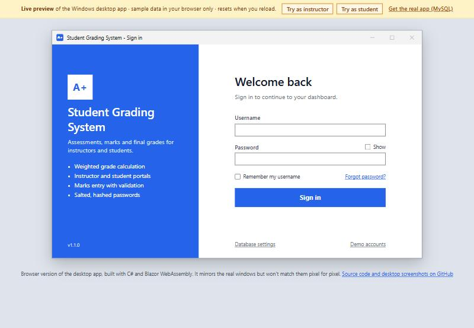
  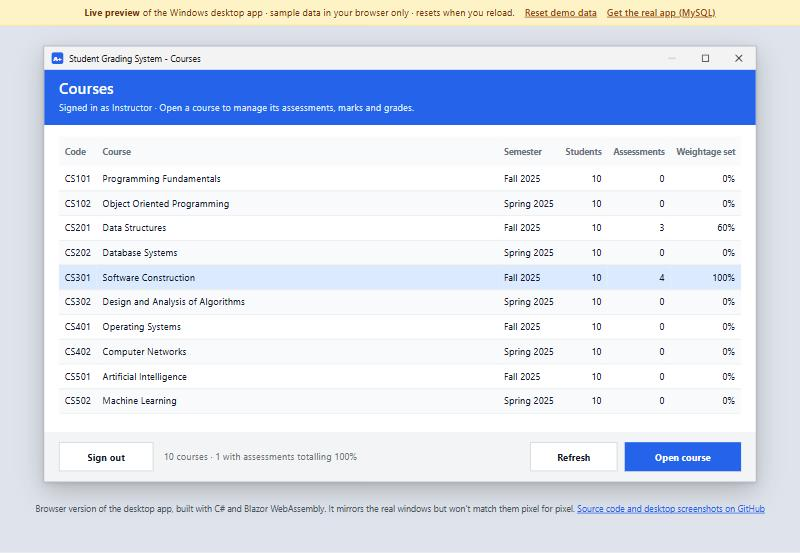
  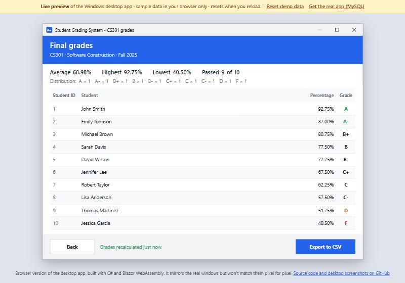
</p>
<p align="center"><sub>Live demo in a browser. Compare it with the desktop screenshots below: same layout and workflow, different rendering.</sub></p>

> Each visitor gets a private copy of the sample data, so nothing you do in the demo is visible to anyone else. There's no server or database behind it at all.

## Screenshots

These are from the real Windows desktop app. The [live demo](#live-demo) looks similar but not identical.

| Sign in | Instructor: courses |
| :---: | :---: |
| 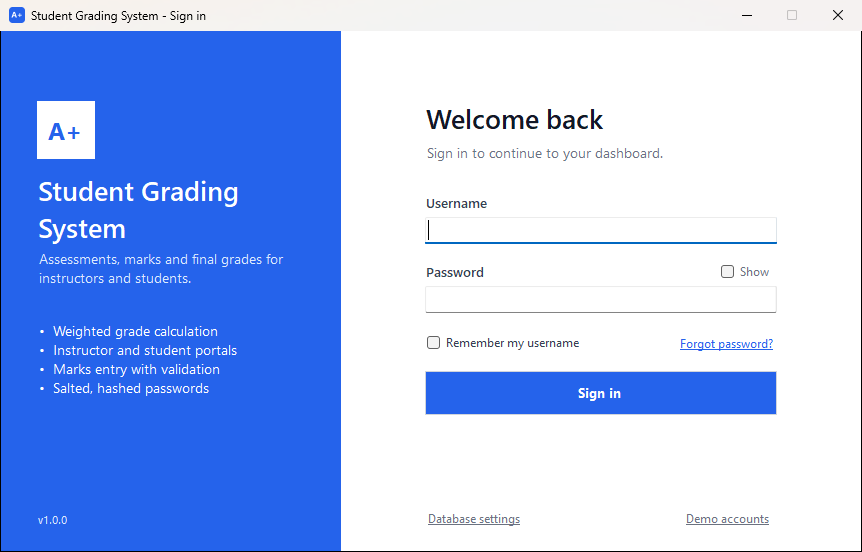 | 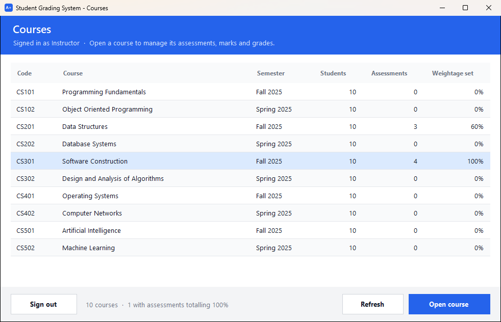 |
| **Instructor: assessments and weightage** | **Instructor: marks entry** |
| 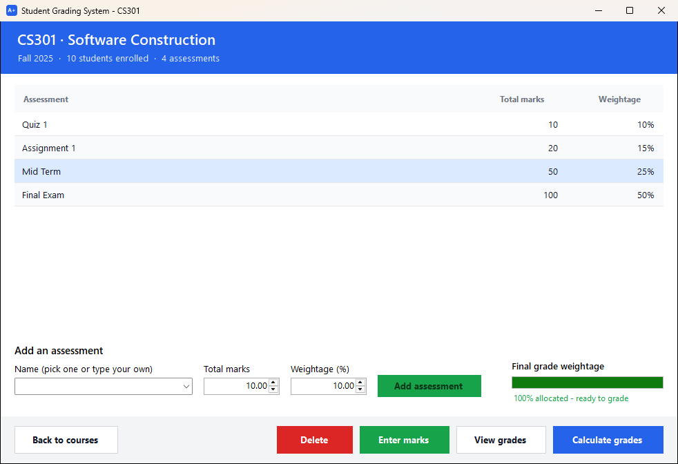 | 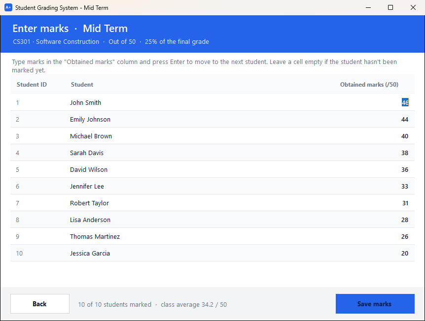 |
| **Instructor: final grades and statistics** | **Student: my courses** |
|  | 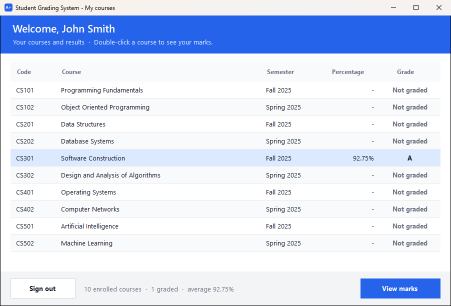 |
| **Student: marks breakdown** | |
| 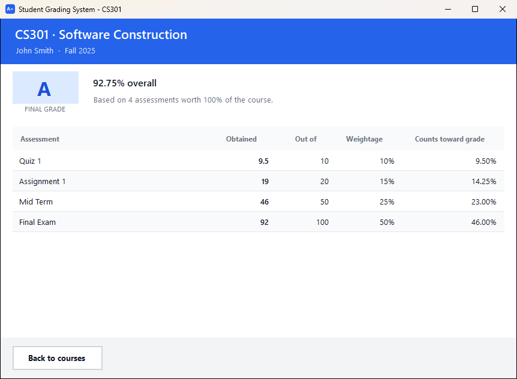 | |

## Tech stack

| Layer | Technology |
| --- | --- |
| Language | C# 12 |
| Desktop UI | Windows Forms on .NET Framework 4.8 (data-bound `DataGridView`, DPI-aware) |
| Live demo | Blazor WebAssembly (.NET 10), hosted on GitHub Pages |
| Data access | [MySqlConnector](https://mysqlconnector.net/) with plain ADO.NET and parameterized SQL |
| Database | MySQL 8.0.16+ (8.4 LTS recommended) |
| Security | PBKDF2-HMAC-SHA256 password hashing (`Rfc2898DeriveBytes`) |
| Testing | xUnit, with integration tests against a real MySQL server |
| Tooling | SDK-style projects, `.editorconfig`, nullable reference types, .NET analyzers |
| CI/CD | GitHub Actions: Windows (build, tests, packaging), Ubuntu (database scripts in Docker), GitHub Pages deployment for the live demo |
| Local database | Optional Docker Compose setup (MySQL 8.4) |

## Getting started

> Just want to look around? Use the [live demo](https://kianis534.github.io/student-grading-system-csharp-mysql/). It needs no setup, but its data resets on reload.
> The steps below install the **full app** and connect it to **your own MySQL database**, so your data is kept.

### Prerequisites

| You want to... | You need |
| --- | --- |
| **Run** the app | Windows 10 or 11 with .NET Framework 4.8 (preinstalled on Windows 10 1903+ and Windows 11) |
| **Store data** | [MySQL Server 8.0.16 or newer](https://dev.mysql.com/downloads/mysql/) (8.4 LTS recommended), or [Docker](https://www.docker.com/) |
| **Build** from source | [.NET SDK 8 or newer](https://dotnet.microsoft.com/download) (CI uses .NET 10) **or** Visual Studio 2022 17.8+ with the *.NET desktop development* workload |

### Option A: download the release (no build needed)

1. Download `StudentGradingSystem-<version>-windows.zip` from the [latest release](https://github.com/Kianis534/student-grading-system-csharp-mysql/releases/latest).
2. Right-click the zip > **Properties** > tick **Unblock** > **OK**, then extract it to a folder you can write to (for example `Documents\StudentGradingSystem`).
3. Create the database by running the bundled setup script from that folder. It asks for your MySQL password:

   ```powershell
   powershell -ExecutionPolicy Bypass -File .\setup-database.ps1
   ```

4. Start `StudentGradingSystem.exe` and sign in with one of the [demo accounts](#demo-accounts).

> Prefer not to use the script? Create the database [manually](#database-setup) and enter your MySQL details in **Database settings** on the sign-in screen.

### Option B: build from source

```bash
git clone https://github.com/Kianis534/student-grading-system-csharp-mysql.git
cd student-grading-system-csharp-mysql
```

Create the database and write your local `Database.config` (it prompts for your MySQL password):

```powershell
.\scripts\setup-database.ps1
```

Build and run:

```bash
dotnet build StudentGradingSystem.sln -c Release
```

```bash
dotnet run --project src/StudentGradingSystem -c Release
```

Or open `StudentGradingSystem.sln` in Visual Studio, set **StudentGradingSystem** as the startup project and press **F5**. All forms open in the Windows Forms designer.

> The first build copies `Database.example.config` to `src/StudentGradingSystem/Database.config`. That file is git-ignored, so your credentials stay on your machine.

### Database setup

Pick whichever suits you. All three load the same scripts from [`database/`](database).

<details open>
<summary><b>1. Setup script (recommended)</b></summary>

```powershell
.\scripts\setup-database.ps1                                   # localhost:3306 as root
.\scripts\setup-database.ps1 -Server 192.168.1.20 -Port 3307 -User admin
.\scripts\setup-database.ps1 -SkipSeed                         # empty database, no demo data
```

The script finds `mysql.exe` (on `PATH` or under `C:\Program Files\MySQL`), runs the schema and seed scripts, and saves a matching `Database.config`. Your password is passed through a temporary option file that's deleted straight away. It never appears on the command line.

</details>

<details>
<summary><b>2. MySQL Workbench or the mysql command line</b></summary>

**MySQL Workbench:** *File > Open SQL Script* > `database/01-schema.sql` > run it (lightning icon). Then do the same with `database/02-seed.sql`.

**Command Prompt or Git Bash:**

```bash
mysql -u root -p < database/01-schema.sql
mysql -u root -p < database/02-seed.sql
```

Then enter your connection details in **Database settings** on the sign-in screen, or edit `Database.config` (see [Configuration](#configuration)).

</details>

<details>
<summary><b>3. Docker (no local MySQL install)</b></summary>

```bash
cp .env.example .env          # then open .env and set your own passwords
docker compose up -d --wait
```

MySQL 8.4 starts on port `3306` (change `MYSQL_PORT` in `.env` if it's taken), with the schema and demo data loaded. In the app, open **Database settings** and use server `localhost`, user `sgs_app` and the `MYSQL_PASSWORD` from your `.env`.

To start over with a clean database: `docker compose down -v`.

</details>

> **Warning:** `01-schema.sql` drops and recreates the `StudentGradingSystem` tables, so running it again deletes existing data in that database.

### Demo accounts

The seed script creates fictional data: 10 courses, 10 students enrolled in every course, a fully graded course (**CS301**) and an in-progress one (**CS201**).

| Role | Username | Password |
| --- | --- | --- |
| Instructor | `instructor` | `Instructor@123` |
| Student | `jsmith` | `Student@123` |
| Student | `ejohnson`, `mbrown`, `sdavis`, `dwilson`, `jlee`, `rtaylor`, `landerson`, `tmartinez`, `jgarcia` | `Student@123` |

> These accounts are for local demos only. Change or remove them before storing real data.

## Configuration

The app reads its MySQL connection string from the first of these that's set:

| Priority | Source | Best for |
| --- | --- | --- |
| 1 | `SGS_CONNECTION_STRING` environment variable | CI, shared machines, keeping secrets out of files |
| 2 | `Database.config` next to `StudentGradingSystem.exe` | Everyday use. Written by the setup script or the **Database settings** dialog |

`Database.config` looks like this ([template](src/StudentGradingSystem/Database.example.config)):

```xml
<appSettings>
  <add key="SGS.ConnectionString"
       value="Server=localhost;Port=3306;Database=StudentGradingSystem;User ID=root;Password=YOUR_MYSQL_PASSWORD;SslMode=Preferred;AllowPublicKeyRetrieval=True" />
</appSettings>
```

Common connection string options (full list in the [MySqlConnector docs](https://mysqlconnector.net/connection-options/)):

| Option | Default in template | Meaning |
| --- | --- | --- |
| `Server` / `Port` | `localhost` / `3306` | Where MySQL is running |
| `Database` | `StudentGradingSystem` | Schema created by `01-schema.sql` |
| `User ID` / `Password` | `root` / *(yours)* | MySQL account. A [least-privilege user](database/create-app-user.sql) is recommended |
| `SslMode` | `Preferred` | Uses TLS when the server supports it |
| `AllowPublicKeyRetrieval` | `True` | Needed for MySQL 8's `caching_sha2_password` when TLS isn't available |

Other files the app uses:

| What | Where |
| --- | --- |
| Remembered username (optional) | Your Windows user profile (`user.config` under `%LOCALAPPDATA%`) |
| Error log for unexpected problems | `%LOCALAPPDATA%\StudentGradingSystem\logs\app-yyyyMMdd.log` |

## How to use it

**Instructor workflow**

1. Sign in as `instructor`. The **Courses** screen lists every course.
2. Double-click a course (or select it and press **Enter**) to open it.
3. Add assessments under **Add an assessment**: pick or type a name, set the total marks and weightage. The progress bar shows how much of the final grade is allocated.
4. Select an assessment and click **Enter marks**. Type marks in the grid (Enter moves down, Esc undoes a cell, **Ctrl+S** saves).
5. Click **Calculate grades** to compute and store everyone's final grade, then **Export to CSV** if you need a copy.

**Student workflow**

1. Sign in as a student (for example `jsmith`).
2. **My courses** shows each enrolled course and its grade, if released.
3. Double-click a course to see every assessment, the marks obtained and how much each one counts toward the final grade.

## How grades are calculated

Each assessment contributes its share of the final grade:

```text
final % = Σ ( obtained marks ÷ total marks × weightage )
```

- An assessment with no marks recorded contributes 0.
- The result is rounded to two decimals (midpoint away from zero) before the letter grade is assigned, so 89.995% becomes 90.00% and earns an A.
- If weightages add up to less than 100%, students are still graded out of 100%. The app warns the instructor before calculating.

| Grade | A | A- | B+ | B | B- | C+ | C | C- | D | F |
| --- | --- | --- | --- | --- | --- | --- | --- | --- | --- | --- |
| **Minimum %** | 90 | 85 | 80 | 75 | 70 | 65 | 60 | 55 | 50 | 0 |

**Worked example:** John Smith in CS301 (seed data)

| Assessment | Obtained / Total | Weightage | Contribution |
| --- | --- | --- | --- |
| Quiz 1 | 9.5 / 10 | 10% | 9.50 |
| Assignment 1 | 19 / 20 | 15% | 14.25 |
| Mid Term | 46 / 50 | 25% | 23.00 |
| Final Exam | 92 / 100 | 50% | 46.00 |
| **Final** | | **100%** | **92.75% = A** |

The rules live in [`GradeCalculator`](src/StudentGradingSystem.Core/Grading/GradeCalculator.cs) and [`GradeScale`](src/StudentGradingSystem.Core/Grading/GradeScale.cs) and are covered by unit tests. An integration test also checks that the app's calculation matches the grades computed in SQL by the seed script.

## Architecture

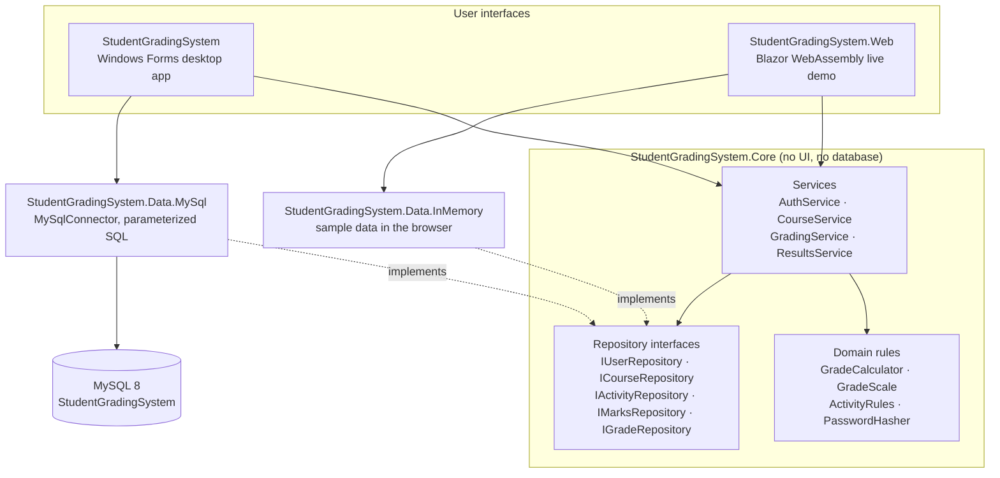

- **User interfaces** only handle display and input. The desktop app wires everything up in `AppServices` (its composition root) and the web demo in `DemoSession`. Neither touches SQL.
- **Services** coordinate each use case: sign-in, adding an assessment, saving marks, calculating grades.
- **Domain rules** are pure functions with no database or UI dependencies, so they're easy to unit test.
- **Repository interfaces** keep storage out of the business logic. The MySQL implementation powers the real app, and the in-memory one powers the live demo and tests. Both are tested against the same scenarios.
- **Core targets both .NET Framework 4.8 and .NET 10**, which is how the same code runs in the WinForms app and in the browser.

## Database schema

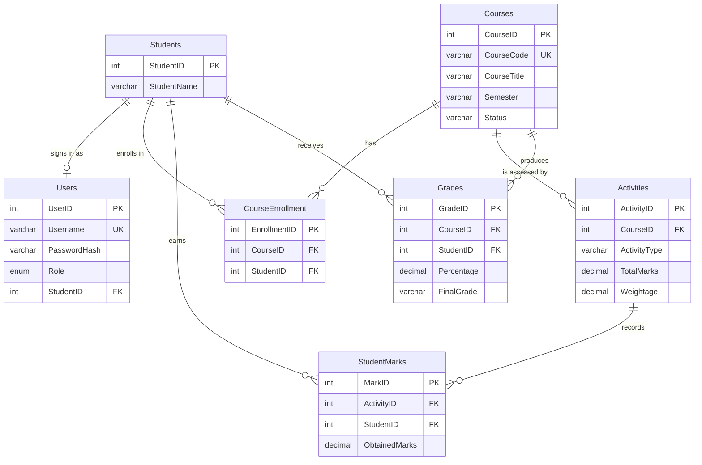

Rules the database enforces on its own:

- Usernames, course codes and assessment names (per course) are unique, and so are enrolments, marks and grades (one per student per course or assessment).
- Student accounts must be linked to a student record. Instructor accounts must not be.
- Total marks > 0, weightage between 0 and 100, obtained marks ≥ 0, percentage between 0 and 100.
- Deleting an assessment deletes its marks, and deleting a course removes its enrolments, assessments and grades.

## Project structure

```text
student-grading-system-csharp-mysql/
├── src/
│   ├── StudentGradingSystem/              # Windows Forms desktop app (net48)
│   │   ├── Forms/                         # Login, dashboards, assessments, marks entry, grades
│   │   ├── Infrastructure/                # Configuration, composition root, theme, navigation, logging
│   │   ├── Resources/app.ico
│   │   ├── Database.example.config        # Connection template (copied to git-ignored Database.config)
│   │   └── Program.cs
│   ├── StudentGradingSystem.Core/         # Business logic shared by desktop and web (net48 + net10.0)
│   │   ├── Data/                          # Repository interfaces
│   │   ├── Grading/                       # Grade scale, weighted calculator, class statistics
│   │   ├── Models/                        # Domain models
│   │   ├── Reporting/                     # CSV export
│   │   ├── Security/                      # PBKDF2 password hashing
│   │   ├── Services/                      # Auth, course, grading and student results services
│   │   └── Validation/                    # Assessment and marks rules
│   ├── StudentGradingSystem.Data.MySql/   # MySQL repositories and friendly error mapping
│   ├── StudentGradingSystem.Data.InMemory/ # In-memory repositories + sample data (live demo, tests)
│   └── StudentGradingSystem.Web/          # Blazor WebAssembly live demo (net10.0)
│       ├── Pages/                         # Sign in, courses, marks entry, grades, student views
│       ├── Services/DemoSession.cs        # One private demo per browser tab
│       └── wwwroot/                       # index.html, styles, icons
├── tests/
│   └── StudentGradingSystem.Core.Tests/   # xUnit: unit, MySQL integration and in-memory tests
├── database/
│   ├── 01-schema.sql                      # Tables, keys and constraints
│   ├── 02-seed.sql                        # Demo courses, students, accounts and marks
│   └── create-app-user.sql                # Optional least-privilege MySQL account
├── scripts/
│   ├── setup-database.ps1                 # Create the database and write Database.config
│   └── package-release.ps1                # Build the release zip
├── docs/images/                           # Screenshots and demo GIF
├── .github/                               # CI, live demo deployment, issue and PR templates
├── docker-compose.yml                     # Local MySQL 8.4 with schema and demo data
├── .env.example                           # Template for docker compose settings
├── Directory.Build.props                  # Shared build settings and version
└── StudentGradingSystem.sln
```

## Testing

```bash
dotnet test StudentGradingSystem.sln -c Release
```

Without a database this runs the unit tests and skips the integration tests. To include them, point the tests at a MySQL server. Each run creates its own `sgs_test_*` database from the real scripts and drops it afterwards:

```powershell
$env:SGS_TEST_CONNECTION_STRING = "Server=localhost;Port=3306;User ID=root;Password=<your password>"
dotnet test StudentGradingSystem.sln -c Release
```

What's covered (107 tests):

| Area | Examples |
| --- | --- |
| Password hashing | Round trip, unique salts, malformed hashes rejected, compatibility with the seed script's hashes |
| Grade rules | Every grade boundary, rounding, missing marks, clamping, class statistics |
| Validation | Duplicate names, out-of-range marks, weightage never exceeding 100% |
| Services | Sign-in (including timing-safe unknown users and hash upgrades), grading, all-or-nothing marks saving |
| CSV export | Quoting, escaping and formula-injection protection |
| MySQL integration | Seeded logins, course summaries, app vs. SQL grade parity, unique constraints, transactional saves, cascading deletes, enrolment-based access, error classification |
| In-memory store (live demo) | The same scenarios as the MySQL tests, so the demo behaves like the real app, plus sample-data parity with `02-seed.sql` |

## Continuous integration

[`.github/workflows/ci.yml`](.github/workflows/ci.yml) runs on every push and pull request:

- **Windows job:** restores, builds with warnings treated as errors, starts MySQL 8.4, runs all 107 tests, packages the release zip and uploads it with the test results as build artifacts.
- **Database job (Ubuntu):** starts the Docker Compose stack, checks the schema and seed data, and confirms the scripts can safely run again.

[`.github/workflows/pages.yml`](.github/workflows/pages.yml) publishes the Blazor WebAssembly demo to GitHub Pages whenever the web app or the shared logic changes.

To run the live demo locally:

```bash
dotnet run --project src/StudentGradingSystem.Web
```

To build a release zip locally:

```powershell
.\scripts\package-release.ps1     # creates artifacts\StudentGradingSystem-<version>-windows.zip
```

## Security

- Passwords are stored as salted **PBKDF2-HMAC-SHA256** hashes (210,000 iterations), never in plain text.
- No credentials are kept in source control. Configuration comes from an environment variable or a git-ignored file.
- All SQL is parameterized, and students can only read courses they're enrolled in.

Read [SECURITY.md](SECURITY.md) for the full list and how to report a vulnerability privately.

## Troubleshooting

| You see | What to do |
| --- | --- |
| My changes disappeared in the live demo | That's by design. The [live demo](https://kianis534.github.io/student-grading-system-csharp-mysql/) keeps data only in your browser tab and resets on reload. Use the desktop app with your own MySQL database to keep data. |
| *"The database connection hasn't been set up yet."* | `Database.config` still holds the template password. Fill in **Database settings** or run the setup script. |
| *"Can't reach the MySQL server."* | Start MySQL (*Services* > **MySQL80** > Start, or `docker compose up -d`) and check the server name and port. |
| *"MySQL rejected the username or password."* | Fix the credentials in **Database settings**. Use **Test connection** to check before saving. |
| *"The StudentGradingSystem database or its tables were not found."* | Run `database/01-schema.sql` and `02-seed.sql` (or the setup script). |
| *"Authentication method 'caching_sha2_password' ..."* | Keep `SslMode=Preferred;AllowPublicKeyRetrieval=True` in the connection string (the default). |
| PowerShell says scripts are disabled | Run `powershell -ExecutionPolicy Bypass -File .\setup-database.ps1`. For a downloaded zip, unblock it first (*Properties > Unblock*). |
| Windows SmartScreen warns about the `.exe` | The release isn't code-signed. Choose *More info > Run anyway*, or build it yourself from source. |
| *"Student Grading System is already running."* | Only one copy can run per Windows session. Check the taskbar. |
| Build error about .NET Framework 4.8 reference assemblies | Use the .NET SDK (`dotnet build` downloads them automatically) or install the .NET Framework 4.8 Developer Pack. |

## Roadmap

- [ ] Admin screens to manage courses, students and enrolments from the app
- [ ] Change-password and admin password-reset flows
- [ ] Assign courses to specific instructors
- [ ] Import marks from CSV or Excel
- [ ] Printable PDF result cards and transcripts
- [ ] GPA/CGPA with credit hours
- [ ] Port the UI to .NET 10 Windows Forms

Ideas and pull requests are welcome. See below.

## Contributing

Contributions are welcome. Please read [CONTRIBUTING.md](CONTRIBUTING.md) for the local setup, coding guidelines and pull request checklist. Found a bug? [Open an issue](https://github.com/Kianis534/student-grading-system-csharp-mysql/issues/new/choose).

## License

Released under the [MIT License](LICENSE). You're free to use, modify and distribute it.

## Author

**Muhammad Abdullah Raja**: [GitHub @Kianis534](https://github.com/Kianis534)

This started as my semester project for the *Software Construction & Development* lab. I later rebuilt it into a layered, tested and documented application. If it helps you, a ⭐ on the repo is appreciated.
